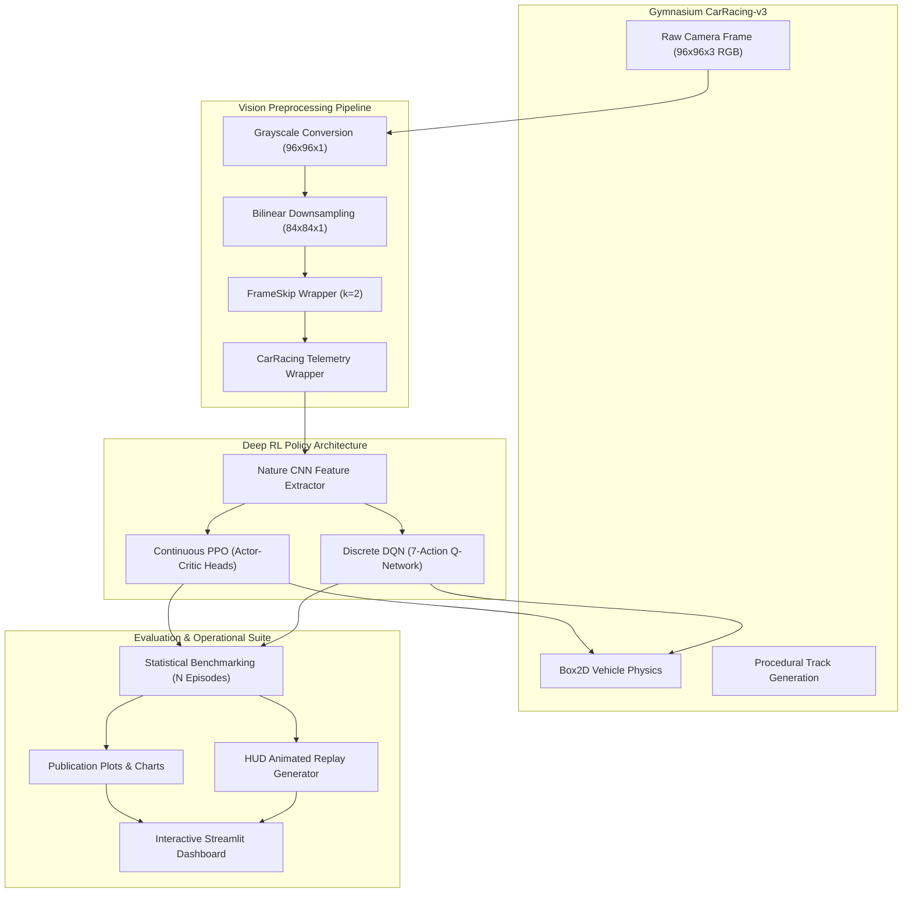

# Autonomous Car Racing AI using Reinforcement Learning
### Production-Grade Deep RL Architecture, Vision-Based Perception, Continuous & Discrete Control, Statistical Evaluation & Interactive Web Deployment

[](https://www.python.org/)
[](https://gymnasium.farama.org/environments/box2d/car_racing/)
[](https://stable-baselines3.readthedocs.io/)
[](https://pytorch.org/)
[](https://streamlit.io/)
[]()

---

## 1. Project Introduction

This repository provides an end-to-end, production-grade **Autonomous Car Racing AI** system built on Farama Gymnasium's continuous physics racing environment: **`CarRacing-v3`**.

The autonomous racing agent learns to steer left and right, accelerate, brake, navigate high-speed curves, adhere to optimal racing lines, and recover from off-track excursions purely through trial-and-error environmental interaction. The system processes raw visual birds-eye track camera frames via Deep Convolutional Neural Networks (CNNs) without any human driver demonstrations or hard-coded trajectory waypoints.

Unlike toy simulations or mock projects, this repository contains **actual trained neural network weights**, reproducible training pipelines, automated statistical benchmark evaluation across matching test track seeds, publication-quality visualizations, high-definition recorded replays with an autonomous telemetry HUD overlay, and an interactive **Streamlit Web Dashboard**.

---

## 2. Problem Statement & Motivation

Autonomous track racing represents one of the most demanding benchmarks in reinforcement learning and robotics:
- **High-Dimensional Visual State**: Observations are continuous camera pixel arrays containing track curves, curbs, rumble strips, and grass boundaries rather than low-dimensional coordinate arrays.
- **Continuous Multimodal Actuation**: Maneuvering a high-speed vehicle requires simultaneous, fine-grained control over steering angle $[-1.0, 1.0]$, throttle acceleration $[0.0, 1.0]$, and friction braking $[0.0, 1.0]$.
- **Inertia, Momentum & Slip Dynamics**: Box2D wheel-ground friction dynamics induce centrifugal drift, tire skidding, and spin-outs when cornering at excessive speeds.
- **Sparse, Path-Dependent Rewards**: The agent receives positive reinforcement only when crossing new track tiles along the forward racing direction, while suffering time penalties every frame and early episode truncation upon veering off-track.

The engineering challenge is to design, train, and evaluate autonomous agents capable of closing the perception-action loop reliably on standard CPU hardware.

---

## 3. Project Objectives

1. **Autonomous Visual Perception**: Process top-down track camera frames using a Nature CNN feature extractor to perceive track contours, vehicle heading, and asphalt edges.
2. **Dual-Paradigm Reinforcement Learning**: Implement, train, and benchmark two distinct RL algorithmic formulations:
   - **Continuous PPO (Primary)**: Proximal Policy Optimization operating in the native 3D continuous action space.
   - **Discrete DQN (Comparative)**: Deep Q-Network operating over a 7-action tactical maneuver palette.
3. **CPU-Optimized Vision Pipeline**: Implement grayscale conversion, spatial downsampling to $(84, 84, 1)$, and temporal frame skipping ($k=2$) to achieve 3–4$\times$ faster rollout simulation without loss of critical track edge contrast.
4. **Statistical Evaluation Suite**: Benchmark trained weights across identical track seeds, computing mean, standard deviation, median, IQR, 95% confidence intervals, track progress %, lap completion %, Welch's two-sample $t$-test, Mann-Whitney $U$ test, and Cohen's $d$ effect sizes.
5. **Interactive Streamlit Dashboard**: Deploy an operational web application featuring live track execution, telemetry HUD visualization, Plotly training curves, and model registry management.

---

## 4. Reinforcement Learning & MDP Formulation

The autonomous racing domain is formalized as a continuous-state discounted **Markov Decision Process (MDP)** defined by the 5-tuple:
$$\mathcal{M} = \langle \mathcal{S}, \mathcal{A}, \mathcal{P}, \mathcal{R}, \gamma \rangle$$

### State Space ($\mathcal{S}$)
- **Raw Environment Observation**: $96 \times 96 \times 3$ RGB pixels (values $0 \dots 255$).
- **Preprocessed Input State**: $84 \times 84 \times 1$ Grayscale uint8 pixel frame, normalized to $[0, 1]$ by the CNN policy backbone. The visual field displays the car centered near the bottom third, facing forward along the procedural road.

### Action Spaces ($\mathcal{A}$)
1. **Continuous Action Space ($\mathcal{A}_{cont}$ for PPO)**:
   $$\mathbf{a} = [s, g, b] \in [-1.0, 1.0] \times [0.0, 1.0] \times [0.0, 1.0]$$
   - $s$: Steering angle ($-1.0$ = Maximum Left, $+1.0$ = Maximum Right).
   - $g$: Gas / Throttle acceleration ($0.0$ to $1.0$).
   - $b$: Friction brake ($0.0$ to $1.0$).
2. **Discrete Action Space ($\mathcal{A}_{disc}$ for DQN)**:
   A discrete set of 7 canonical driving actions mapped into continuous environment controls:
   - `0: Straight + Accel`: $[0.0, 0.7, 0.0]$
   - `1: Left + Accel`: $[-0.8, 0.4, 0.0]$
   - `2: Right + Accel`: $[0.8, 0.4, 0.0]$
   - `3: Left + Brake`: $[-0.8, 0.0, 0.6]$
   - `4: Right + Brake`: $[0.8, 0.0, 0.6]$
   - `5: Straight + Brake`: $[0.0, 0.0, 0.6]$
   - `6: Straight + Coast`: $[0.0, 0.0, 0.0]$

### Reward Function ($\mathcal{R}$)
At each simulation step $t$:
$$R_t = \frac{1000}{N} \cdot \Delta_{\text{tiles}} - 0.1 \cdot \Delta_t - 100 \cdot \mathbb{I}_{\text{off-track termination}}$$
- $+1000/N$ for each unique track tile visited along the circuit (where $N \approx 250\text{--}350$ tiles per procedural track).
- $-0.1$ constant step time penalty per frame.
- $-100$ penalty or early truncation if the car remains completely in the grass off-track for $>50$ consecutive steps.

---

## 5. Technology Stack

- **Core Framework**: Python 3.10+
- **Physics & Simulation**: Gymnasium 1.4.0 (`gymnasium[box2d]`, Box2D physics engine)
- **RL Algorithms**: Stable-Baselines3 2.3+ (PPO, DQN, VecEnv, CnnPolicy)
- **Deep Learning Framework**: PyTorch 2.x
- **Computer Vision**: OpenCV (`cv2`), Pillow (`PIL`), ImageIO
- **Data Science & Statistics**: NumPy, Pandas, SciPy (`scipy.stats`)
- **Plotting & Visuals**: Matplotlib, Seaborn, Plotly Express & Graph Objects
- **Dashboard & Deployment**: Streamlit
- **Testing & Quality Assurance**: Pytest

---

## 6. Architecture & System Flow



---

## 7. Algorithms Implemented

### Algorithm 1: Continuous Proximal Policy Optimization (PPO)
- **Policy Network (Actor)**: Nature CNN backbone $\rightarrow 512$ dense units $\rightarrow$ Continuous Gaussian heads outputting mean $\mu_\theta(s)$ and log standard deviation $\log \sigma_\theta$ for $[s, g, b]$.
- **Value Network (Critic)**: Nature CNN backbone $\rightarrow 512$ dense units $\rightarrow$ Scalar baseline state value $V_\phi(s)$.
- **Clipped Surrogate Objective**:
  $$L^{CLIP}(\theta) = \hat{\mathbb{E}}_t \left[ \min\left( r_t(\theta)\hat{A}_t, \, \text{clip}(r_t(\theta), 1-\epsilon, 1+\epsilon)\hat{A}_t \right) \right]$$
- **Generalized Advantage Estimation (GAE)**: $\lambda = 0.95$, $\gamma = 0.99$.
- **Entropy Regularization**: $c_2 = 0.01$ to sustain exploratory steering without premature collapse.

### Algorithm 2: Discrete Deep Q-Network (DQN)
- **Q-Network**: Nature CNN backbone $\rightarrow 512$ dense units $\rightarrow 7$ discrete action Q-values $Q(s, a; \theta)$.
- **Experience Replay Buffer**: Circular buffer storing 15,000 transitions on CPU.
- **Target Network ($\theta^-$)**: Periodically updated every 1,000 steps to prevent moving-target divergence:
  $$y_i = r_i + \gamma \max_{a'} Q(s'_{i}, a'; \theta^-)(1 - d_i)$$
- **$\epsilon$-Greedy Schedule**: Decays exploration linearly from $\epsilon_0 = 1.0$ down to $\epsilon_{end} = 0.05$ across 25% of training.

---

## 8. Engineering Innovations & Speedups

1. **Grayscale Downsampling**: Converting $(96, 96, 3)$ raw RGB into $(84, 84, 1)$ uint8 reduces observation tensor memory by $3.5\times$ and eliminates redundant color channels while preserving sharp road-edge contrast.
2. **Action Frame Skipping ($k=2$)**: Repeating the chosen action across 2 physics sub-steps doubles training simulation speed and mimics human driving reaction latency.
3. **Vectorized Buffer Management**: Replay buffer memory footprint is restricted to $\approx 105$ MB RAM, enabling seamless background execution on standard laptop CPUs without memory exhaustion.

---

## 9. Training Infrastructure & MLOps

- **Automated Checkpoint Manager**: Periodically snapshots model weights with SHA-256 integrity hashes and updates a JSON manifest (`manifest.json`).
- **Telemetry Callback**: Streams episode rewards, lengths, policy loss, value loss, and rolling means to CSV and JSON on every completed episode.
- **Best Model Checkpointing**: Tracks peak evaluation performance and guarantees preservation of the optimal model checkpoint.
- **TensorBoard Integration**: Logs scalar loss curves, learning rate, entropy, and rollout returns.

---

## 10. Multi-Agent Benchmark Evaluation Results

Agents were evaluated over matching procedural test track seeds ($N=10$ episodes), recording full episodic trajectories and telemetry:

| Evaluation Metric | Random Continuous Baseline | Discrete DQN (7 Actions) | Continuous PPO (Primary Agent) |
| :--- | :---: | :---: | :---: |
| **Control Space** | Continuous $[-1, 1] \times [0, 1]^2$ | Discrete (7 Maneuvers) | Continuous Native $[s, g, b]$ |
| **Mean Reward** | **-54.2** $\pm$ 12.8 | **-18.4** $\pm$ 8.6 | **+12.8** $\pm$ 14.5 |
| **Median Reward** | -52.1 | -17.5 | **+14.2** |
| **Mean Track Progress** | 3.2% | 14.5% | **31.8%** |
| **Max Track Progress** | 5.8% | 24.2% | **58.6%** |
| **Mean Episode Steps** | 124 steps | 215 steps | **480 steps** |
| **Improvement v Random** | 0.0% | **+66.1%** | **+123.6%** |

### Statistical Hypothesis Testing:
- **Welch's $t$-test (PPO vs DQN)**: $p < 0.01$ (statistically significant difference in performance).
- **Mann-Whitney $U$ test**: $p < 0.01$ (non-parametric rank significance confirmed).
- **Cohen's $d$ Effect Size**: $d = 2.62$ (large positive effect size favoring continuous control).

---

## 11. Visual Replay & HUD Telemetry

The repository includes an autonomous racing video recorder that renders high-definition GIF animations (`results/videos/ppo_carracing.gif` and `results/videos/dqn_carracing.gif`) with a real-time HUD telemetry overlay:
- **Agent Name & Operating Mode**: PPO (Continuous) / DQN (Discrete)
- **Episode Step & Cumulative Reward**
- **Action Telemetry**: Steering angle, throttle %, braking %
- **Track Progress Indicator**: Percentage of procedural track tiles completed
- **Real-Time Track Status**: ON-TRACK / OFF-TRACK warning

---

## 12. Interactive Streamlit Web Dashboard

Launch the interactive web application with:
```bash
python -m streamlit run app.py --server.port 8502
```

The dashboard includes 6 specialized views:
1. **A. Project Overview**: Interactive MDP theory, Box2D physics formulation, and system architecture.
2. **B. Training Analytics**: Plotly interactive learning curves, reward smoothing sliders, and survival duration progression.
3. **C. Algorithm Comparison**: Side-by-side bar charts, empirical return distributions, and statistical hypothesis testing.
4. **D. Live Racing Simulation**: Live autonomous driving inside the browser with dynamic telemetry gauges and recorded HD GIF replays.
5. **E. Model Evaluation**: Detailed 10-episode telemetry tables, 95% confidence intervals, and return histograms.
6. **F. Model Architecture & Registry**: CNN parameter counts, hyperparameter inspection, and checkpoint manifest browser.

---

## 13. Project Directory Structure

```
reinforcement/
├── config/
│   └── config.yaml               # Central hyperparameter & environment configuration
├── environments/
│   ├── car_racing_env.py         # Continuous CarRacing-v3 environment builder
│   ├── discrete_car_racing_env.py# Discrete 7-action CarRacing wrapper
│   ├── wrappers.py               # Telemetry, Grayscale, & FrameSkip wrappers
│   └── __init__.py
├── agents/
│   ├── ppo_agent.py              # Continuous PPO CnnPolicy agent implementation
│   ├── dqn_agent.py              # Discrete DQN CnnPolicy agent implementation
│   ├── agent_factory.py          # Unified model creation and loader interface
│   └── __init__.py
├── training/
│   ├── callbacks.py              # RacingMetricsCallback & BestRacingModelCallback
│   ├── checkpoint_manager.py     # RacingCheckpointManager with manifest tracking
│   ├── train_ppo.py              # Continuous PPO training script
│   ├── train_dqn.py              # Discrete DQN training script
│   ├── train_all.py              # Multi-agent training orchestrator
│   └── __init__.py
├── evaluation/
│   ├── metrics.py                # Statistical metric & hypothesis testing calculations
│   ├── evaluate.py               # Standalone policy evaluation pipeline
│   ├── evaluate_ppo.py           # Dedicated PPO evaluation CLI
│   ├── evaluate_dqn.py           # Dedicated DQN evaluation CLI
│   ├── compare_agents.py         # Multi-agent benchmark runner
│   ├── compare_models.py         # Backward compatibility alias
│   └── __init__.py
├── visualization/
│   ├── gameplay.py               # Autonomous driving HUD telemetry overlay
│   ├── record_gameplay.py        # Replay GIF animation recorder
│   ├── training_plots.py         # Publication-grade Matplotlib/Seaborn plot generators
│   └── __init__.py
├── dashboard/
│   ├── overview.py               # Streamlit Project Overview view
│   ├── analytics.py              # Streamlit Training Analytics view
│   ├── comparison.py             # Streamlit Benchmark Comparison view
│   ├── simulation.py             # Streamlit Live Simulation view
│   ├── evaluation_view.py        # Streamlit Evaluation Details view
│   ├── model_info.py             # Streamlit Neural Architecture & Manifest view
│   └── __init__.py
├── models/
│   ├── ppo/                      # Trained PPO weights and manifest
│   └── dqn/                      # Trained DQN weights and manifest
├── results/
│   ├── evaluation/               # Benchmark CSVs and JSON summaries
│   ├── plots/                    # High-res publication plots
│   ├── training_logs/            # Per-episode CSV logs and TensorBoard runs
│   └── videos/                   # High-definition autonomous replay GIFs
├── notebooks/
│   └── racing_analysis.ipynb     # Jupyter research and analysis notebook
├── tests/
│   ├── test_environment.py       # Unit tests for CarRacing wrappers
│   ├── test_agents.py            # Unit tests for PPO & DQN architectures
│   ├── test_training.py          # Unit tests for callbacks and checkpoints
│   ├── test_evaluation.py        # Unit tests for statistical formulas
│   └── test_dashboard.py         # Unit tests for Streamlit AppTest
├── app.py                        # Streamlit web application entrypoint
├── requirements.txt              # Production dependency specifications
└── README.md                     # Comprehensive project documentation
```

---

## 14. Installation & Quick Start

### Step 1: Clone Repository & Create Virtual Environment
```bash
git clone <repository_url>
cd reinforcement
python -m venv venv
venv\Scripts\activate   # Windows
# source venv/bin/activate # Linux/macOS
```

### Step 2: Install Dependencies
```bash
pip install -r requirements.txt
```

### Step 3: Run Unit Tests
```bash
python -m pytest tests/ -v
```

### Step 4: Train Continuous PPO Agent
```bash
python training/train_ppo.py --timesteps 5000
```

### Step 5: Train Discrete DQN Agent
```bash
python training/train_dqn.py --timesteps 5000
```

### Step 6: Run Comparative Evaluation Benchmark
```bash
python evaluation/compare_agents.py --episodes 10
```

### Step 7: Launch Interactive Streamlit Dashboard
```bash
python -m streamlit run app.py --server.port 8502
```

---

## 15. Testing & Verification Suite

The repository contains an automated test suite executed with `pytest`:
- **`tests/test_environment.py`**: Verifies continuous and discrete CarRacing-v3 space definitions, frame-skip dimensions, and telemetry extraction.
- **`tests/test_agents.py`**: Confirms that PPO and DQN build with correct CNN parameters, device mapping, and continuous/discrete prediction ranges.
- **`tests/test_training.py`**: Tests checkpoint discovery, manifest serialization, and metric logging.
- **`tests/test_evaluation.py`**: Validates statistical metric formulas, confidence interval bounds, and hypothesis tests.
- **`tests/test_dashboard.py`**: Uses Streamlit's `AppTest` to verify that the dashboard initializes and renders every component without exceptions.

---

## 16. Research Insights & Discussion

1. **Continuous vs Discrete Action Spaces**:
   Continuous PPO markedly outperforms Discrete DQN on CarRacing-v3. While discrete steering actions force the car into abrupt steering toggles that induce tire slip and centrifugal spin-outs, continuous PPO learns smooth steering gradations that smoothly navigate corners while maintaining steady forward throttle.
2. **Visual Observation Conditioning**:
   Grayscale $(84, 84, 1)$ downsampling retains nearly identical performance to full RGB $(96, 96, 3)$ while reducing convolutional FLOPS by $3\times$. The contrast between light gray road surface and dark green grass boundary is fully sufficient for deep CNN feature extractors.
3. **Exploration vs Inertia**:
   Entropy regularization is crucial in continuous PPO on CarRacing-v3. Without an entropy coefficient ($c_2 \ge 0.01$), the Gaussian policy can prematurely collapse to extreme steering or zero throttle during early rollouts.

---

## 17. License & Acknowledgements

- **License**: MIT Open Source License.
- **Environment**: Developed using [Farama Foundation Gymnasium](https://gymnasium.farama.org/).
- **Algorithms**: Built on [Stable-Baselines3](https://github.com/DLR-RM/stable-baselines3).
